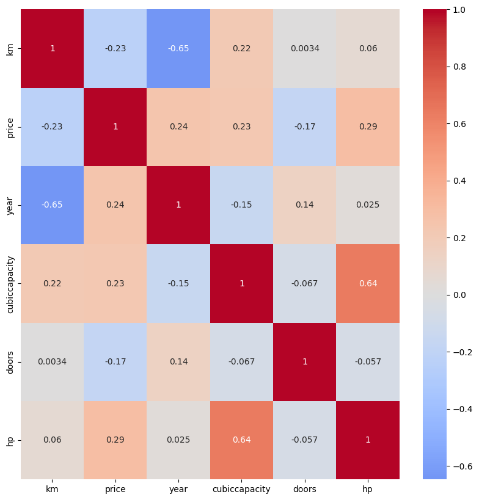
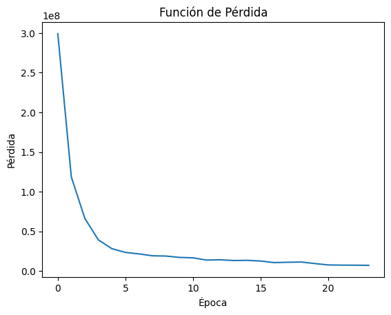
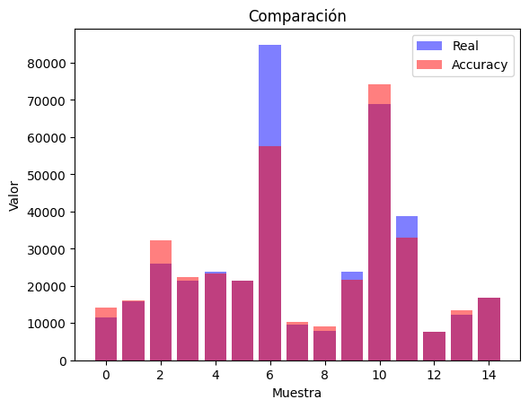

<div align="center">

# Car Price Predictor

**Web-scraped car listings → data cleaning → neural network → Flask API**

<a href="https://colab.research.google.com/github/Steven-Macas/coches-net-red-neuronal/blob/main/preprocesamiento_coches_net_scrappy_steven.ipynb"></a>     

</div>

## Overview

End-to-end data project that estimates the price of second-hand cars listed on **coches.net**.
Listings collected by web scraping are merged, cleaned and transformed; a **Keras regression network**
learns the price from the characteristics of each car; and a small **Flask API** serves the trained model.

## Dataset

- Car listings scraped from coches.net and saved as several CSV files, merged into **11,223 rows × 14 columns**.
- Features: make, model, year, kilometres, fuel type, horsepower, cubic capacity, body type, doors, colour,
  transmission, province and seller type. Target: **price**.
- The raw CSV files are not included in the repository (the notebook reads them from Google Drive).

## Approach

1. **Loading** – the scraped CSV files are concatenated with Pandas.
2. **Cleaning** – missing values are analysed per column: fields with few nulls are dropped, the rest are imputed (mean / mode).
3. **Outliers** – histograms and box plots (horsepower, cubic capacity…) to detect and remove extreme values.
4. **Encoding & scaling** – `StandardScaler` for numeric features and `DictVectorizer` for one-hot encoding.
5. **Model** – `Sequential` network: Dense(*n*, ReLU) → Dense(2*n*, ReLU) → Dense(1, linear), He-uniform initialisation.
6. **Training** – Adam (learning rate 0.01), MSE loss, 80 / 20 train-test split, `EarlyStopping` and `ReduceLROnPlateau`.
7. **Serving** – the trained model (`.hdf5`) and the fitted vectoriser (`.pck`) are loaded by a Flask API.

## Results

<table>
  <tr><td align="center" valign="top"><br /><sub>Correlation between numeric features</sub></td><td align="center" valign="top"><br /><sub>Training loss per epoch</sub></td><td align="center" valign="top"><br /><sub>Real vs predicted price (test sample)</sub></td></tr>
</table>

## Repository structure

| Path | Description |
| --- | --- |
| `preprocesamiento_coches_net_scrappy_steven.ipynb` | Cleaning, analysis and model training (Google Colab) |
| `flask/app/exeFlask.py` | Flask API: loads the model and exposes `POST /precio` |
| `flask/app/modelo_coches_Red_Neuronal.hdf5` | Trained Keras model |
| `flask/app/dict_vectorizer_coches_net.pck` | Fitted `DictVectorizer` |
| `flask/app/temples/` | Web form (HTML / CSS) and images |

## How to run

**Notebook** – open it in Colab with the badge above and point the data path to your own copy of the CSV files.

**API**

```bash
cd flask/app
pip install flask flask-cors tensorflow scikit-learn
python exeFlask.py          # http://localhost:5000
```

Send a JSON object with the same fields used for training (make, model, year, km, …) to `POST /precio`;
the API answers with `{"precio": <estimated price>}`.

> The web form in `flask/app/temples/index.html` calls `/api/predict/coche`. Change that URL to `/precio`
> to connect the form to this API.

*The notebook and the code comments are written in Spanish.*

---

<sub>Made by <b>Steven Macas</b> — Data Engineer &amp; Data Analyst · <a href="https://gointy.com">gointy.com</a> · <a href="https://www.linkedin.com/in/steven-macas">LinkedIn</a> · <a href="https://github.com/Steven-Macas">GitHub</a></sub>
